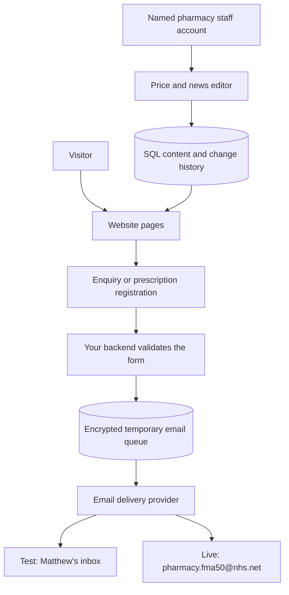

# How the backend works

## In plain English

The website is the part a visitor sees. The backend is the program running on your hosting server. SQL is the language it uses to read and change information in a database. The browser never receives the database password, encryption key or email-service key.



An email-delivery provider transports the email; it does not own the contact form or website logic. The adapter currently supports Resend as an implementation candidate, not a selected or approved processor for patient information. The pharmacy must approve the provider, processing terms and location/security of processing before any real patient details pass through it. An approved SMTP or other provider can replace this adapter if needed.

## What has been built

- Server-rendered public pages, so the main content works without JavaScript.
- SQLite database with SQL tables for content, named users, sessions, change history and the outgoing email queue. SQLite is a database file, not a cloud account. For this modest single-server service it keeps the demonstration simple; a larger deployment can migrate to PostgreSQL.
- Enquiry and prescription authorisation forms with validation on the server, size limits, a honeypot, per-address rate limits, request-origin checks and expiring form tokens.
- Password hashes using scrypt, random hashed session tokens, eight-hour sessions, HttpOnly/SameSite cookies, CSRF checks and HTML escaping. Secure cookies and HSTS apply with HTTPS.
- Authenticated staff editing of prices/news, draft/published news, optimistic concurrency checks, and an audit record of the editor. All current staff accounts have the same content-editing permissions. They cannot read patient submissions in the editor.
- AES-256-GCM encryption of queued form contents. In local demo only, the key is generated in the data directory. In hosting, it must be supplied separately through the host's secret manager.
- The email adapter sends plain text to a server-configured recipient, with the visitor's address only in Reply-To. It cannot be used as an arbitrary-recipient email relay.
- A persistent queue survives restarts. Failed sends are retried with increasing delays and an idempotency key. After 23 hours unresolved sends become “needs-review”, before the provider's 24-hour deduplication window expires. Investigation must check provider records before any manual resend. There is no automatic resend after that point.
- Provider-accepted payloads are removed from the active queue. Other payloads expire after seven days by default; delivery metadata expires after 30 days. These are provisional operational defaults, not an approved pharmacy retention policy. SQLite/WAL files and backups may retain older pages until their own lifecycle completes; use encrypted disks and defined backup expiry. Email and provider retention are separate.

“Accepted by provider” does not mean “received in the inbox”. The editor makes that distinction. The visitor confirmation says received for processing, not delivered to the pharmacy. Live delivery/bounce monitoring and alerting must be configured with the selected provider before launch.

## The three modes

| Mode | What happens | Appropriate data |
|---|---|---|
| `APP_MODE=demo`, `MAIL_MODE=preview` | Saves an encrypted local demonstration; never emails | Fictional only |
| `APP_MODE=test`, `MAIL_MODE=resend` | Sends to `TEST_EMAIL` | Fictional only; current recipient is Matthew's Gmail address |
| `APP_MODE=live`, `MAIL_MODE=resend` | Sends to the configured pharmacy address | Only after all launch checks are complete |

Live mode requires HTTPS, a separate encryption key, email settings and `LAUNCH_APPROVED=yes`. That setting is an operational guard, not a compliance certification. The current privacy and complaints pages are drafts, and the production authentication/monitoring work below is still required. Do not switch it on merely to remove the demonstration banner.

The personal test email is stored in the local ignored `.env` file. Change test settings through hosting environment variables, not browser JavaScript. Test mode refuses to send without an explicit recipient; live mode uses the pharmacy address from `app/config.js`.

## What you need to arrange, and what I can do next

| You / pharmacy | Implementation work I can do |
|---|---|
| Identify your present host and domain registrar, and set a monthly budget | Select a compatible deployment approach and configure it once chosen |
| Choose/approve an email provider and own its account | Connect the adapter, configure a verified sending address and test failures/delivery |
| Authorise DNS access | Add the provider-specified SPF/DKIM records and an appropriate DMARC policy; avoid overwriting existing NHS/mail records |
| Provide named staff members and their emails | Provision accounts, configure production MFA/identity protection and document offboarding |
| Approve handling of registration details by email | Configure processor, retention and operational controls around that decision |
| Pharmacy approves privacy/complaints wording and clinical copy | Incorporate signed-off wording and complete launch checks |
| Someone can inspect the pharmacy inbox during launch | Run a fictional-data live-recipient test and verify receipt/reply before opening forms |
| Agree a technical owner after handover | Configure backups, monitoring, restore practice and an update/renewal schedule |

Your current Git remote is a GitHub repository and CNAME indicates a custom domain, but that does not prove the live host is GitHub Pages. If it is, GitHub Pages cannot run this server. We would keep the domain and repository while moving hosting to a service supporting a persistent Node process and private disk. Do not push this replacement to an existing Pages deployment as though it were static HTML.

## Hosting requirements

- One supported Node 24.x process and a persistent local disk, with a separate private `DATA_DIR`.
- HTTPS reverse proxy, exact `SITE_ORIGIN`, automatic process restart and restricted network access.
- Private staging behind host-level authentication; noindex is not access control.
- Separate demo, staging and production databases, keys, accounts and credentials. Never reuse the demo database in production.
- Backups stored off-host in encrypted storage, with access controls and expiration. Keep encryption keys separately recoverable.
- Provider delivery/bounce alerts, queue-failure alerts and uptime checks assigned to an actual person.
- Production MFA via an approved identity/access layer or implementation before public staff access. The local sign-in currently uses password authentication only; recovery/account creation is an operator task, not self-service.
- Rate limits currently use the socket address and in-memory counters. Behind a proxy all visitors may share one limit; configure trusted-proxy handling and edge-level abuse limits deliberately. Do not blindly trust arbitrary X-Forwarded-For values. Counters/form tokens reset on restart; sessions and queued emails persist.
- Security review and final choice of the SQLite driver/runtime before accepting patient data. No external penetration test has been performed.

## Accounts

Set `STAFF_PASSWORD` securely in the local session/host environment, then use:

```powershell
node --env-file-if-exists=.env app/accounts.js add person@example.com "Staff name"
node --env-file-if-exists=.env app/accounts.js reset person@example.com
node --env-file-if-exists=.env app/accounts.js disable person@example.com
```

Add/reset requires a unique password of at least 14 characters. Clear the temporary environment variable afterwards. Do not put passwords in a shared script or command-line argument. Reset and disable revoke existing sessions. Use a password manager for credentials and record staff access ownership. The demo account credentials are in `data/demo-access.txt` only.

## Backup and restore

```powershell
node --env-file-if-exists=.env app/backup.js
```

This uses SQLite's backup API to create a consistent snapshot in `backups/`; copying only a running `.sqlite` file can miss changes in the WAL. Copy snapshots into approved encrypted off-host storage and expire them according to policy. This command does not schedule or upload backups automatically.

Restore into a separate private staging directory first: stop that server, preserve its current data directory for rollback, place the snapshot as `pharmacy.sqlite` in the new empty directory, set `DATA_DIR` to it and supply the matching key. Do not combine a restored snapshot with old WAL/SHM files. Start in non-sending test mode, verify prices/news/accounts and queue metadata, then carry out the agreed recovery plan. Restored queues can replay old pending messages: keep email disabled until reconciled with provider records. Delete copied sessions before reopening staff access. Test restoration before launch and periodically afterwards.

## Learning SQL using fictional data

Read `app/store.js` to see the schema. A row in `users` represents one person; `sessions.user_id` links sign-ins to that person. The current content is stored as JSON in one revisioned row so price/news changes are atomic. The queue stores encrypted text, not searchable clinical records.

Example parameterised query from the application:

```sql
SELECT * FROM users WHERE email = ? AND active = 1;
```

The value is bound separately, so user input is not treated as SQL code. For learning, use a copy of the demo database, inspect the tables, change fictional content and restore a snapshot. Do not experiment against the production database.

## Relevant technical references

- [Node SQLite API](https://nodejs.org/docs/latest-v24.x/api/sqlite.html)
- [OWASP SQL injection prevention](https://cheatsheetseries.owasp.org/cheatsheets/SQL_Injection_Prevention_Cheat_Sheet.html)
- [OWASP CSRF prevention](https://cheatsheetseries.owasp.org/cheatsheets/Cross-Site_Request_Forgery_Prevention_Cheat_Sheet.html)
- [Resend email API](https://resend.com/docs/api-reference/emails/send-email) — candidate integration, subject to pharmacy approval.
